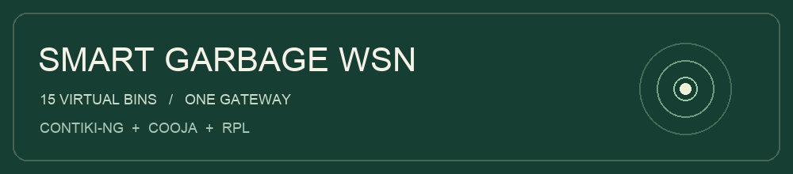
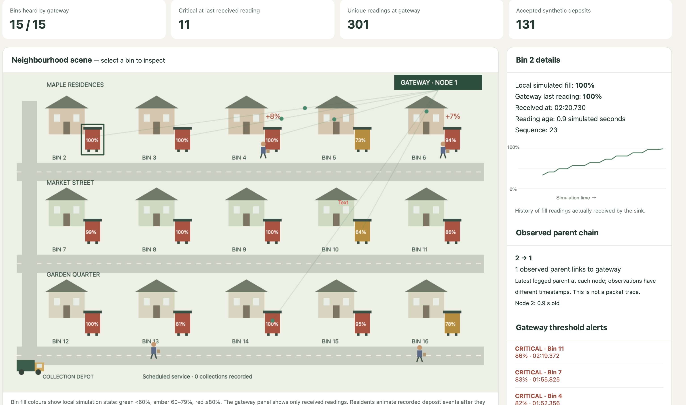
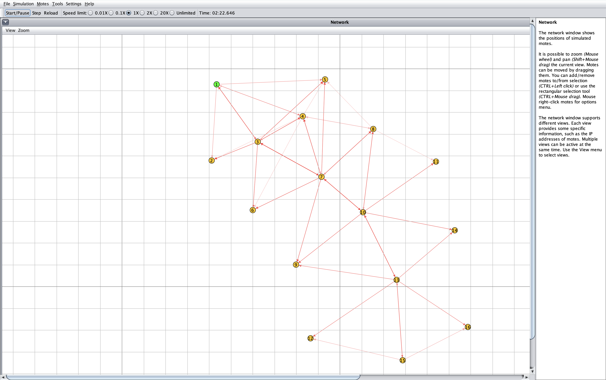

# 🌿 Smart Garbage Neighbourhood WSN

A software-only smart garbage bin monitoring project using Contiki-NG and Cooja, with a Python-powered browser dashboard.

## 🖼️ Project screenshots

### Neighbourhood dashboard


Browser dashboard showing bin status and routing observations. The street layout and animations are illustrative; parent links come from logged RPL observations.

### Cooja wireless network


Sixteen simulated nodes: one gateway and fifteen bins. Node colours identify application types. Radio-traffic arrows show activity, not a complete end-to-end packet trace.

## Academic project

- **Students:** Anandita Nagpal and Navroop Singh Walia
- **Programme:** B.Tech Computer and Communication Engineering, final year
- **University:** Manipal University Jaipur
- **Subject:** Wireless Sensors And Adhoc Networks
- **Faculty:** Dr. Lal Pratap Verma

## 📡 Features

- 15 virtual garbage bins and one gateway: node 1 is the gateway; nodes 2–16 represent bins.
- UDP reporting over RPL Lite and 6LoWPAN.
- Synthetic resident deposits that increase local bin fill.
- Gateway alerts when received readings cross the 80% critical threshold.
- Scheduled collection events that empty bins meeting the threshold.
- Live log viewing and recorded replay in a neighbourhood dashboard.
- Logged RPL preferred-parent observations and a selected parent-chain display.

## Files

| File | Purpose |
|---|---|
| `udp-client.c` | Bin behaviour, deposits, scheduled collection, reporting and parent logging |
| `udp-server.c` | RPL root, received readings and threshold alerts |
| `Makefile` | Contiki-NG application build configuration |
| `neighbourhood-demo.csc` | Cooja simulation configuration |
| `neighbourhood-live.txt` | Recorded simulation log |
| `Smart_Garbage_Neighbourhood_Routing.py` | Local dashboard server with embedded recorded demonstrations |

## ⚙️ Run the dashboard

Requires Python 3. From this repository's directory:

```bash
python3 Smart_Garbage_Neighbourhood_Routing.py
```

Open http://127.0.0.1:8767 in a browser.

Recorded replay uses the embedded demonstration data. Connect live reads `neighbourhood-live.txt` beside the Python file. An existing log can be viewed without Cooja running; new live events require a running simulation writing to that file.

Keep the Terminal process running. Press Control+C in its Terminal tab to stop the dashboard.

## ⚙️ Run the Cooja simulation

This repository contains application files, not the Contiki-NG simulator or its toolchain.

1. Obtain Contiki-NG with its required submodules and configure a working Cooja build.
2. Place this repository's folder directly inside `contiki-ng/examples/`. The Makefile uses `CONTIKI=../..`.
3. From that application folder, compile:

```bash
make udp-client.cooja TARGET=cooja
make udp-server.cooja TARGET=cooja
```

4. Launch Cooja from `contiki-ng/tools/cooja`, using a Java version compatible with your Cooja build.
5. Open `neighbourhood-demo.csc` from the application folder.
6. Preserve the supplied recording before running: the configuration appends output to `neighbourhood-live.txt`.
7. Start the simulation. For live dashboard updates, run the Python dashboard from this same application folder and select Connect live.

Our verified environment used macOS on Apple Silicon and Java 25. Native mote compilation also requires the appropriate development tools.

## ♻️ Simulation behaviour

Bin fill and resident deposits are synthetic application inputs. Reporting uses a nominal five-second interval with jitter in the current configuration.

Collection visits begin approximately 240 simulated seconds after startup, with eight-second slots between bins. Visits repeat every 360 seconds per bin. A visit empties a bin only when its local fill is at least 80%.

Collection is a predetermined simulated service. The gateway does not dispatch or optimise the truck.

## Interpretation and limitations

- The browser street layout, resident motion and truck animation are illustrative.
- Local simulated fill and the gateway's last received reading are displayed separately.
- Parent chains combine the latest logged preferred-parent observations from different timestamps. They are not traces of individual packets.
- Animated delivery dots do not measure individual radio hops.
- This project uses no physical sensors or microcontrollers.
- Energy consumption, battery lifetime and routing-failure recovery have not been validated.
- Earlier fixed-rate versus adaptive-reporting experiments used a different synthetic filling model. Their results must not be presented as measurements of this enhanced collection scenario.
- Throughput and goodput must identify their measurement layer, byte accounting and observation window; application logs alone do not measure total radio traffic.

## Acknowledgement

The application builds on Contiki-NG's `examples/rpl-udp` example. Upstream copyright and licence notices must be retained where applicable. Consult the Contiki-NG repository for its licensing and documentation.

Contiki-NG: https://github.com/contiki-ng/contiki-ng
