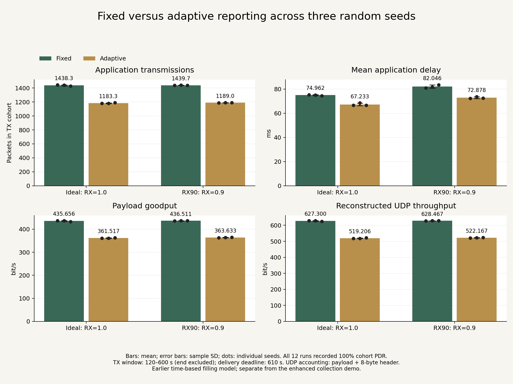

# Multi-seed reporting evaluation

Twelve Cooja runs compare two reporting policies, two radio settings,
and three random seeds using the earlier synthetic time-based filling model.

## Experiment matrix

| Setting | Values |
|---|---|
| Reporting policy | Fixed; adaptive |
| Random seed | 123456; 234567; 345678 |
| Ideal radio | TX=1.0, RX=1.0 |
| RX90 radio | TX=1.0, RX=0.9 |
| Transmission range | 50 m |
| Interference range | 100 m |
| Nodes | One gateway and fifteen bins |

Fixed reporting uses a nominal five-second interval.
Adaptive reporting uses nominal intervals of 15 seconds below 60% fill,
five seconds at 60–79%, and two seconds at 80% or higher, with jitter.

RX90 is a configured radio-model setting, not an expected application PDR.

## Results

See [individual and summary results](RESULTS.md) and
[machine-readable results](results.csv).

Bars show across-seed means. Error bars show sample standard deviations.
Dots show individual seeds. There is one run per matrix combination;
repeating seed 123456 reproduces the earlier baseline rather than adding
a new independent seed.

All twelve recordings had 100% measured cohort PDR.
Average delay increased under RX90 for both reporting policies.
Three seeds provide a limited assessment of variation; these results
do not establish performance across arbitrary networks.

Lower goodput under adaptive reporting reflects fewer transmitted readings.
Energy savings, battery lifetime and improved alert latency were not measured.

## Measurement definitions

- TX cohort: 120 <= send time < 600 simulated seconds.
- Delivery deadline: 610 simulated seconds.
- Packet identity: sender node ID and sequence number.
- PDR: matched cohort deliveries divided by cohort transmissions.
- Delay: first matching reception minus send-log time.
- Rate window: 120 <= first reception time < 600 seconds.
- Goodput: unique received payload bits divided by 480 seconds.
- Reconstructed UDP throughput: payload plus eight UDP-header bytes
  per unique received packet, divided by 480 seconds.

UDP accounting excludes IP/MAC overhead, control traffic,
acknowledgements and retransmissions. Delay averages cover delivered packets.

## Reproduce the analysis

Run from the repository root:

    python3 experiments/multi-seed/summarize.py

This regenerates results.csv and RESULTS.md from the twelve preserved logs.
It reuses the analyzer in experiments/fixed-vs-adaptive/analyze.py.

Graph generation additionally requires Matplotlib:

    python3 experiments/multi-seed/plot_results.py

The graph was generated with Matplotlib 3.10.6.

## Rerun the simulations

The configs/ directory preserves the twelve configurations used.
These configurations share generic udp-client.c and udp-server.c paths;
the filename alone does not select the reporting policy.

1. Create a separate application directory directly inside contiki-ng/examples/.
2. Copy Makefile and udp-server.c from ../fixed-vs-adaptive/source/
   into that application directory.
3. Select udp-client-fixed.c or udp-client-adaptive.c from that source archive
   and copy it into the application directory as udp-client.c.
4. Copy the desired configuration from configs/ into the same directory.
5. Update the copied client's timestamp and compile both applications:

       touch udp-client.c
       make udp-client.cooja TARGET=cooja
       make udp-server.cooja TARGET=cooja

6. Open the selected configuration in Cooja as a fresh simulation.
   Confirm its title, seed, radio settings and zero start time.
7. Run through at least 610 simulated seconds; these recordings continued
   beyond 620 seconds.
8. Save each run to its own fresh log destination.

Check the configuration's append destination before starting.
Existing logs must be moved aside or a new destination selected to avoid
combining multiple runs. Preserve this repository's evidence logs.

Repeat the client selection and rebuild when changing reporting policies.
Keep topology, radio ranges and other controls unchanged across comparisons.

See the root README for the recorded Contiki-NG and Cooja revisions.
These experiments are separate from the enhanced deposit-and-collection demo.
